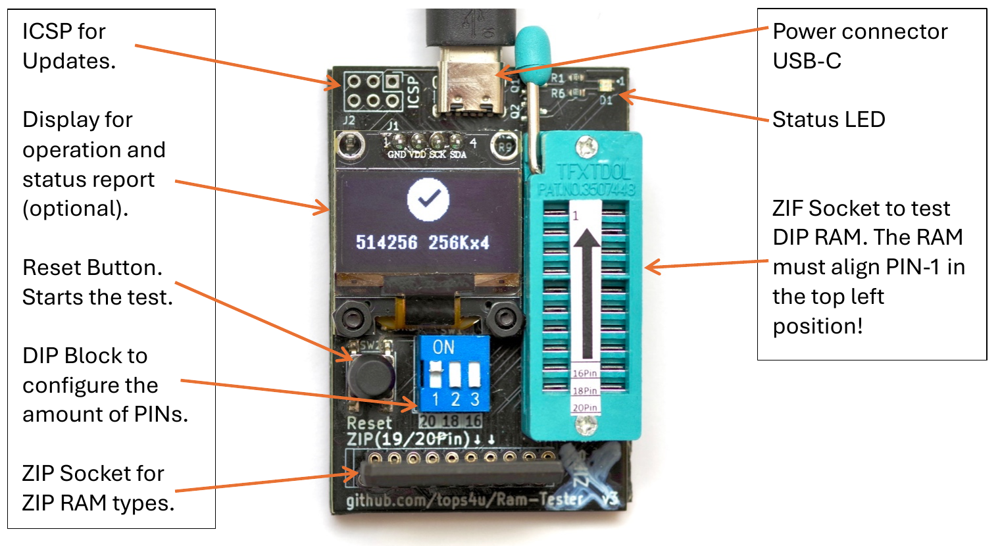
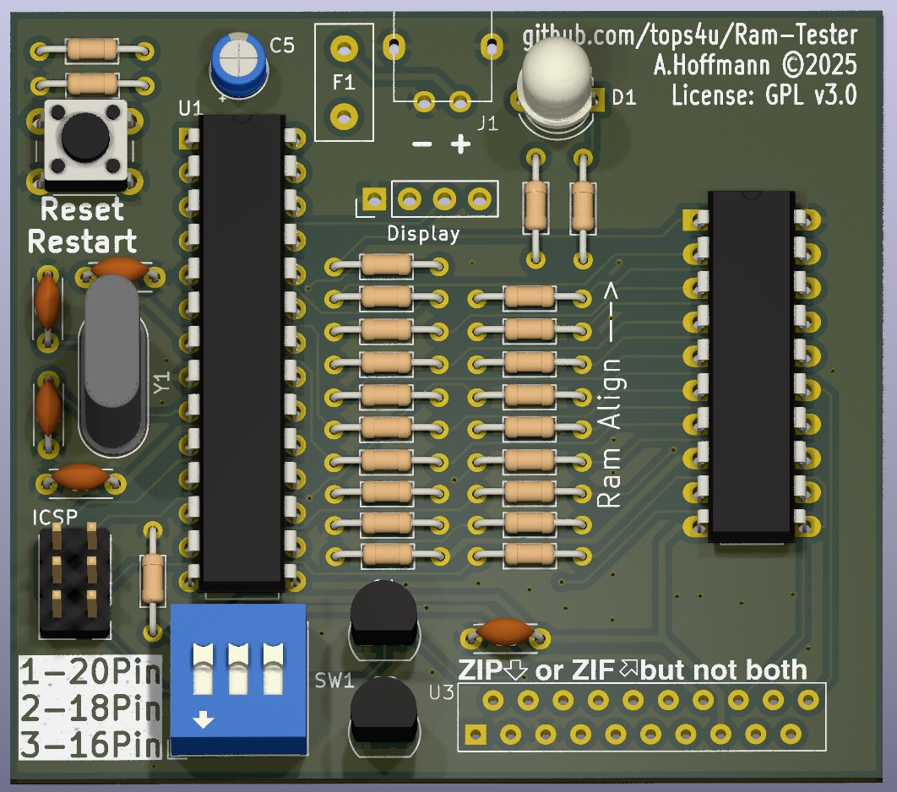
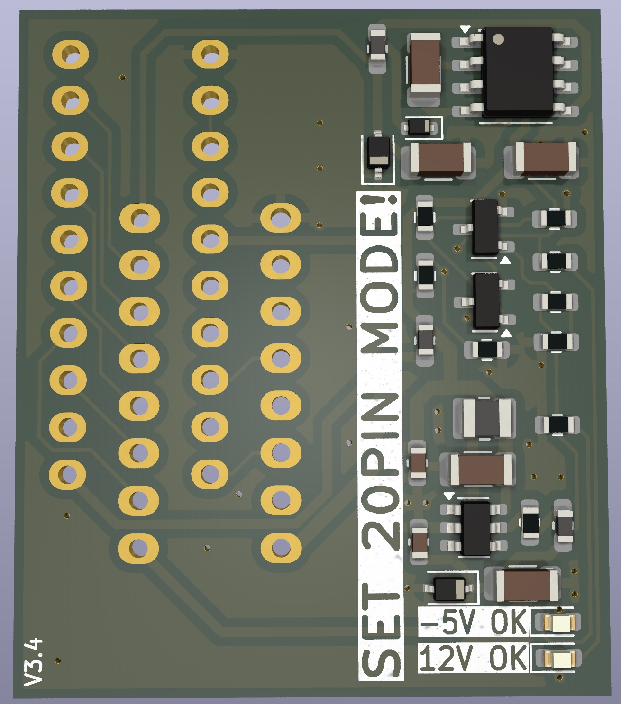
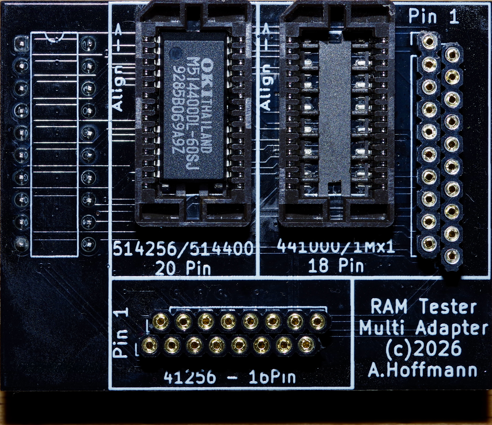
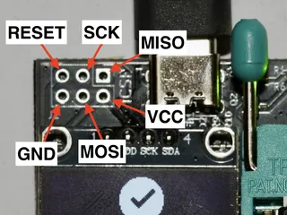

# RAM Tester User Manual

For firmware **5.1.2**, the SMD board **v3.1**, the through-hole (THT) board **v3.0**, the 4116 adapter **v3.4** and the Multi Adapter (ZIP/SOJ).

Printable version: [Manual_5.x.pdf](Manual_5.x.pdf)

<!-- toc -->
## Contents

- [About this manual](#about-this-manual)
- [1. First start: the self-test](#1-first-start-the-self-test)
- [2. Operating the tester](#2-operating-the-tester)
- [3. 4116 adapter](#3-4116-adapter)
- [4. Multi Adapter (ZIP/SOJ)](#4-multi-adapter-zipsoj)
- [5. Settings (Setup mode)](#5-settings-setup-mode)
- [6. Self-test reference](#6-self-test-reference)
- [7. Error messages](#7-error-messages)
- [8. Technical data](#8-technical-data)
- [Appendix A: Socket pin map](#appendix-a-socket-pin-map)
- [Appendix B: Firmware update](#appendix-b-firmware-update)
- [Appendix C: Further documents](#appendix-c-further-documents)
<!-- /toc -->

---

## About this manual

This manual assumes that you built the tester yourself from one of the two kits:

- **SMD kit:** the SMD parts are already on the board. You soldered the ZIF socket, the ZIP socket, the DIP switch, the pin headers and the display. An [assembly video](https://youtu.be/SPN98FYMu7Y) shows the steps.
- **Through-hole (THT) kit:** you soldered everything yourself.

Both boards work the same way. Where they differ, this manual says so.

The display is optional. Every result is also shown by the LED, so each step below tells you what to expect on both. Only the [Setup mode](#5-settings-setup-mode) really needs a display.

### Safety notes

> [!WARNING]
> The tester is a laboratory and development tool for technically experienced users. Use it at your own risk. The manufacturer accepts no liability for damage to equipment, property or persons resulting from assembly, incorrect operation or use. Any claims for warranty, repair or return are excluded.

- Use only a stabilised 5 V USB supply (max. 1 A). Supply and cable are not included.
- Use the tester in a controlled lab environment, away from flammable materials.
- RAM chips are sensitive to electrostatic discharge. Use appropriate ESD protection during assembly, testing and use. The SMD board has a TVS diode and a ferrite bead on the supply input, the THT board has neither. Neither board has certified protection against ESD, overvoltage, overcurrent or EMC interference.
- The tester is not intended for unattended continuous operation or for connection to other systems.
- The board has a resettable fuse. If the tester shuts down, unplug it and remove the chip. Once the fault is gone, the fuse recovers by itself after a short time. A long-lasting short can heat the fuse above 60 °C.
- This product does not take part in any WEEE take-back system. You may send it back for disposal at the end of its life.

### The board



*SMD board. The display sits inside the board outline.*



*THT board v3.0, shown without display and without the ZIF socket. The display sits in the middle of the board, above the block of 47 Ω resistors. The ZIF socket goes to the right, the ZIP socket is at the bottom edge.*

> [!NOTE]
> Older photos and videos may show a display that overhangs the board edge. Those are earlier board revisions.

On both boards, chips are always described with the USB connector at the top. The ZIF socket is on the right. Its pins are numbered like a 20-pin DIP chip:

```text
                 top of board (ZIF lever side)

      Pin  1 (top left)    o   o   Pin 20 (top right) = GND
      Pin  2               o   o   Pin 19
      Pin  3               o   o   Pin 18
      Pin  4               o   o   Pin 17
      Pin  5               o   o   Pin 16
      Pin  6               o   o   Pin 15
      Pin  7               o   o   Pin 14
      Pin  8               o   o   Pin 13
      Pin  9               o   o   Pin 12
      Pin 10               o   o   Pin 11
```

---

## 1. First start: the self-test

Run the self-test once after building, before you trust any test result. It does not need a RAM chip.

The tester checks three things:

1. The three pull-down resistors of the DIP switch.
2. Shorts between the socket lines.
3. With your help and a piece of wire, that every ZIF contact reaches the ATmega.

The automatic part takes about 8 seconds. The wire test takes a minute or two.

**You need:**

- a 5 V USB supply and cable
- about 15 cm of thin, stiff wire (solid core works well)
- a multimeter, if something fails

> [!TIP]
> If you have not soldered the display yet, run the self-test without it first. The LED reports every step, and the parts underneath are still easy to reach: on the THT board the 47 Ω resistor block, on the SMD board R3, R4 and R5.

A self-test video is available [here](https://youtu.be/qTgzcuxilXE).

### Step 1: Check the board before power-up

Look over your solder joints with a magnifier. Look for bridges between neighbouring pins of the ZIF socket, the ZIP socket, the DIP switch and the pin headers, and for joints that did not flow.

On the THT board, also check:

- the ATmega: notch at the top, all pins seated, none folded under the chip
- C5: polarity (the `+` mark on the board)
- the dual LED: orientation
- Q1 and Q2: orientation

### Step 2: Start the self-test

1. Remove all chips from the ZIF and ZIP sockets. Remove any adapter.
2. Set **all three DIP switches to OFF**.
3. Connect the USB supply. If the tester already has power, press **RESET**.

**What you should see**

| | |
|---|---|
| Display | `Self Test` on the left, a QR code on the right, the firmware version at the bottom left |
| LED | alternates red and green for 2.5 seconds |

**If this step fails**

| Symptom | Likely cause | What to do |
|---|---|---|
| LED and display stay dark | No 5 V on the board | Measure between ICSP pin 2 (+5 V) and pin 6 (GND). It should read about 5 V. If not, unplug and look for a short between 5 V and GND. The fuse may have tripped and needs a moment to recover. Try another cable and supply. On the THT board, check the USB connector joints and C5. |
| 5 V is present, still nothing happens | ATmega not running | Check all ATmega pins, the crystal Y1 and its capacitors C2 and C3. An ATmega you sourced yourself needs firmware first, see [Appendix B](#appendix-b-firmware-update). |
| LED works, display stays dark | Display wiring | Both boards expect the header order 1 GND, 2 VCC, 3 SCK, 4 SDA. Display modules with VCC and GND swapped do not fit. Check the four joints. The firmware drives SSD1306 displays only. |
| LED colours are swapped (THT) | Dual LED rotated | Turn the LED by 180°. |
| `Check DIP`, LED blinks red fast | Two switches are ON | Set all switches to OFF and press RESET. |
| `Setup` appears | All three switches are ON | Unplug, set all switches to OFF, plug in again. Do not move switches while the Setup page is showing, see [Section 5](#5-settings-setup-mode). |
| `Defect or no RAM!`, or another RAM error, although all switches are OFF | One DIP line reads high | The self-test only starts if all three lines read low. Check that the switches really are OFF and that R3, R4 and R5 are in place (see Step 3). Look for a bridge from ZIF pin 8, 9 or 10 to +5 V. |

### Step 3: Resistor check (automatic)

The tester checks the three 1 MΩ pull-down resistors on the DIP switch lines. This takes about 1.5 seconds.

**What you should see**

| | |
|---|---|
| Display | `Self Test` stays on, then changes to `Resistors OK` / `Checking Shorts` |
| LED | steady green |

**If this step fails**

| | |
|---|---|
| Display | `Self Test Fail!` / `Resistors` |
| LED | steady red |

One of the DIP lines does not fall low on its own. Without a working pull-down, the tester cannot read the switch reliably.

| Resistor | DIP switch | ZIF pin | Where on the SMD board | Where on the THT board |
|---|---|---|---|---|
| R3 | 1 (20 pin) | 10 | top side, below the crystal, under the display | above the reset button, the lower of the two resistors |
| R4 | 2 (18 pin) | 9 | same group | central resistor block, left column, second from the bottom |
| R5 | 3 (16 pin) | 8 | same group | upright resistor between the ICSP header and the ATmega |

Unplug the tester and measure between ZIF pin 20 (GND) and ZIF pins 8, 9 and 10, with all switches OFF. Each should read about 1 MΩ. If one reads much higher, check that resistor and its joints. If one reads close to 0 Ω or a pin is tied to +5 V, look for a solder bridge. A faulty DIP switch can cause this too.

### Step 4: Short check (automatic)

The tester drives each socket line low in turn and checks all the others. This takes about 4 seconds.

**What you should see**

| | |
|---|---|
| Display | `Resistors OK` / `Checking Shorts` |
| LED | green, may flicker, a short red flash at the end |

**If this step fails**

| | |
|---|---|
| Display | `Self Test Fail!` / `Shorts ZIF/ZIP` |
| LED | steady red |

Two socket lines are connected, or a line is tied to GND. The tester does not tell you which one, so you have to find it:

1. Make sure that the ZIF and ZIP sockets are empty and no adapter is plugged in. A chip causes this message.
2. Unplug the tester. Check the ZIF socket, the ZIP socket and the 47 Ω resistors for solder bridges. On the SMD board, the arrays are on the bottom side. Also look at the ATmega pins.
3. With the multimeter in continuity mode, check neighbouring ZIF pins (1 to 2, 2 to 3, and so on) and each pin against pin 20 (GND).

The ZIP socket is wired in parallel to the ZIF socket, so a bridge at the ZIP socket shows up on the ZIF pins too. [Appendix A](#appendix-a-socket-pin-map) shows which pins belong together.

> [!NOTE]
> ZIF pin 8, 9 and 10 read about 1 MΩ against GND. That is correct. Pin 10 also has a 100 nF capacitor to GND, so the meter may beep briefly.

### Step 5: Wire test (manual)

When the short check has passed, the tester waits for you.

**What you should see**

| | |
|---|---|
| Display | `No Shorts found` / `Wire Pin20->all` |
| LED | steady orange |

> [!CAUTION]
> Do not touch the DIP switches during this step. With the wire on GND, a switch set to ON would short the 5 V supply.

**Procedure**

1. Open the ZIF lever, put one end of the wire into **ZIF pin 20** (top right) and close the lever. The wire is now clamped.
2. Leave the lever closed. Press the free end of the wire into the contact opening of ZIF pin 1.
3. The LED flashes green for about 0.2 seconds. The pin is now registered.
4. Do the same for all other pins, 2 to 19, in any order. That makes **19 flashes** in total.

Good to know:

- Each pin flashes only once per run. A second touch does nothing.
- **Pin 15 looks different.** The LED goes dark for a moment and then stays red as long as the wire touches the pin. This line also drives the green LED and the display, so this is normal.

**If this step fails**

If the LED stays orange after you have touched all pins, one pin has not registered. Go over all pins again. Only the missing pin will flash, so if a pin gives no flash on any attempt, that is your line. Then look for the cause in this order:

1. **Bad contact.** Press the wire in more firmly. Then try the same line at the ZIP socket ([Appendix A](#appendix-a-socket-pin-map) gives the ZIP pin). If it flashes there, the fault is the ZIF contact or its solder joint.
2. **Short.** A line bridged to +5 V is not found in Step 4, because that test only looks for lines being pulled low. Check the line against +5 V (ICSP pin 2).
3. **Defective 47 Ω resistor.** Measure from the ZIF contact to the matching ATmega pin in the table below. It should read about 47 Ω. If it is open, check the resistor and its joints.
4. **Lifted ATmega pin.** If the far end of the resistor is fine but the ATmega pin itself does not read 47 Ω, the pin is not soldered properly. Inspect it under a magnifier and reflow it. On the THT board, also check for a pin bent under the chip.

| ZIF pin | Line | SMD: resistor | SMD: ATmega pin | THT: resistor | THT: ATmega pin |
|---|---|---|---|---|---|
| 1 | IO1 | RN4 section 4 | 23 | R9 | 23 |
| 2 | IO2 | RN4 section 3 | 24 | R10 | 24 |
| 3 | WE | RN1 section 1 | 15 | R16 | 17 |
| 4 | RAS | RN1 section 3 | 13 | R14 | 15 |
| 5 | A9 | R8 | 27 | R8 | 27 |
| 6 | A0 | RN3 section 1 | 30 | R17 | 2 |
| 7 | A1 | RN3 section 2 | 31 | R18 | 3 |
| 8 | A2 | RN3 section 3 | 32 | R19 | 4 |
| 9 | A3 | RN3 section 4 | 1 | R20 | 5 |
| 10 | Vcc 20-pin | none, direct | 28 | none, direct | 28 |
| 11 | A4 | RN2 section 4 | 2 | R21 | 6 |
| 12 | A5 | RN2 section 3 | 9 | R22 | 11 |
| 13 | A6 | RN2 section 2 | 10 | R23 | 12 |
| 14 | A7 | RN2 section 1 | 11 | R24 | 13 |
| 15 | A8 | R7 | 16 | R7 | 18 |
| 16 | OE | RN1 section 2 | 14 | R15 | 16 |
| 17 | CAS | RN1 section 4 | 12 | R13 | 14 |
| 18 | IO3 | RN4 section 2 | 25 | R11 | 25 |
| 19 | IO4 | RN4 section 1 | 26 | R12 | 26 |

On the SMD board, RN1 to RN4, R7 and R8 are on the bottom side. Each array holds four resistors. Section *n* is the resistor between pads *n* and 9−*n*.

### Step 6: Finish

**What you should see**

| | |
|---|---|
| Display | a check mark and `Self Test OK` |
| LED | steady green |

If pin 15 was your last pin, the LED stays red until the wire leaves that pin. Pull the wire away and the result appears.

### Step 7: First real test

1. Unplug the tester and remove the wire.
2. Set the DIP switch for your chip, see [Section 2](#2-operating-the-tester).
3. Test a chip you know is good.

If the good chip passes, your tester is ready. To run the self-test again at any time, set all switches to OFF and press RESET.

---

## 2. Operating the tester

### 2.1 Quick start

1. **Set the DIP switch** to the pin count of your chip.
2. **Insert the chip** into the ZIF socket or the ZIP socket, never both.
3. **Connect the USB supply**, or press **RESET** if the tester already has power.
4. **Wait.** The LED turns orange and may flicker.
5. **Read the result** on the display or from the LED code.

To test the next chip, swap the chip and press RESET.

### 2.2 DIP switches

| Switch 1 | Switch 2 | Switch 3 | Mode | Chips |
|---|---|---|---|---|
| **ON** | OFF | OFF | 20-pin | 44256, 44258, 514256, 514258, 514400, 514402. Also the [4116 adapter](#3-4116-adapter) with 4116, 4027 |
| OFF | **ON** | OFF | 18-pin | 4416, 4464, 411000, 2114 |
| OFF | OFF | **ON** | 16-pin | 3732, 4532, 4816, 4164, 41256, 41257 |
| OFF | OFF | OFF | Self-test | No chip! See [Section 1](#1-first-start-the-self-test) |
| **ON** | **ON** | **ON** | Setup | No chip! See [Section 5](#5-settings-setup-mode) |
| any other combination | | | Invalid | Shows `Check DIP`, LED blinks red fast |

The board marks the switches as `20 18 16` (SMD) or `1-20Pin 2-18Pin 3-16Pin` (THT).

Two things are worth knowing:

- The switches are read once, at power-up or RESET. Changing a switch later has no effect until the next RESET.
- The switch connects 5 V to the supply pin of the chip: ZIF pin 10, 9 or 8. If you set the wrong pin count, the chip gets no power on its supply pin, and the tester usually reports `Defect or no RAM!`. So check the switch before you call a chip dead.

### 2.3 ZIF socket

Use the ZIF socket for all DIP chips.

- Pin 1 of the chip goes to the **top left**. The notch points up, to the lever side.
- **Always push the chip all the way to the top**, whatever its size. The markings 16, 18 and 20 show where the lower end of the chip sits.
- Close the lever before you press RESET. An open lever gives `Defect or no RAM!`.

> [!CAUTION]
> **2114 SRAM: insert it rotated by 180°.** Pin 10 goes to the top left, pin 1 to the lower right, and the chip still sits all the way at the top. The 2114 has its power pins swapped compared to the DRAMs. Inserted the normal way, it gets reverse polarity.

### 2.4 ZIP socket

The on-board ZIP socket takes these 20-pin ZIP chips: **44256, 44258, 514256, 514258, 514400, 514402**. Some of them have only 19 pins and fit the same way. Set switch 1 (20-pin).

- Pin 1 of the chip goes to the **square pad at the left**, in the row closest to the board edge.
- The **marking on the chip faces the board edge**.

A ZIP chip also fits the wrong way round, so check this every time.

> [!CAUTION]
> **Never fill the ZIF and ZIP sockets at the same time.** They are wired in parallel. This also applies when an adapter is plugged in.

> [!CAUTION]
> **Never put a 1M×1 chip (411000, 511000) or a 41256 in ZIP form into the on-board ZIP socket.** Their pinout is different, and the chip can be destroyed. These chips go into the [Multi Adapter](#4-multi-adapter-zipsoj).

### 2.5 What happens during a test

The tester finds the chip type by itself. You only set the pin count.

| Order | What the tester does |
|---|---|
| 1 | Checks all pins for shorts to GND and to VCC |
| 2 | Checks that a chip is present and identifies its type |
| 3 | Tests the address lines and decoders in both directions |
| 4 | Checks for stuck cells and crosstalk with two checkerboard passes |
| 5 | Writes random data and reads it back after the retention time, twice, the second time inverted |
| 6 | In Loop mode only: tests the refresh counter (see [Section 5](#5-settings-setup-mode)) |

Every test uses the access mode of the chip: Fast Page Mode, Static Column or Nibble Mode.

While the test runs, the display shows `RAM-TESTER`, `Detected:`, the chip name and `Checking...`. With a 4164 and 32K mode on, it shows `4164 or 32Kx1`, because the final type is only known at the end. The test takes between 0.2 and about 20 seconds, see the table in [Section 2.7](#27-supported-chips).

### 2.6 Reading the result

**Chip OK:** the display shows a check mark and the chip name. The LED repeats a green and orange code. The green blinks give the group, the orange blinks the type, see [Section 2.7](#27-supported-chips).

> [!IMPORTANT]
> Check that the detected type is the chip you inserted. Some faults make a chip look like a different, smaller type. A 41256 reported as `4164 64Kx1` is defective.

Some results need a closer look:

| Display | Meaning |
|---|---|
| `4164 64Kx1 4ms` | The chip meets the 4 ms retention time. |
| `4164 64Kx1 2ms` | The chip failed at 4 ms and passed at 2 ms. Most computers need the 4 ms part. The LED code is the same as for 4 ms, so only the display shows the difference. |
| `3732-L 32K`, `3732-H 32K`, `4532-3 32K`, `4532-4 32K` (black on white bar) | The chip has errors, but one half works. It can serve as this half-good 32K type. If the chip is marked 4164, it is **defective as a 4164**. |
| Two names, such as `3732-H/4532-4 32K` | Only one quadrant has errors, so the chip can serve as either type. |
| `2114 1Kx4-20`, `-30`, `-45` | The 2114 is OK. The suffix is its approximate speed class, as a rough indication only. |

Details on the 32K types are in the [32K documentation](32K-Option).

**Chip faulty:** the display shows a cross or warning symbol and the reason. The LED repeats a red code. See [Section 7](#7-error-messages).

Both results stay until you press RESET or remove power.

### 2.7 Supported chips

| Chip | Organisation | DIP switch | Socket | Retention | Test time | LED code (green, orange) |
|---|---|---|---|---|---|---|
| 4027 | 4K×1 | 1 | [4116 adapter](#3-4116-adapter) | 2 ms | 0.2 s | 4, 2 |
| 4116 | 16K×1 | 1 | [4116 adapter](#3-4116-adapter) | 2 ms | 0.5 s | 4, 1 |
| 4816 | 16K×1 | 3 | ZIF | 2 ms | 0.7 s | 1, 4 |
| 4416 | 16K×4 | 2 | ZIF | 4 ms | 1.7 s | 2, 1 |
| 3732 | 32K×1 | 3 | ZIF | 2/4 ms | 1.8 s | 1, 6 |
| 4532 | 32K×1 | 3 | ZIF | 2/4 ms | 1.8 s | 1, 5 |
| 4164 | 64K×1 | 3 | ZIF | 2/4 ms | 1.8 s | 1, 1 |
| 4464 | 64K×4 | 2 | ZIF | 4 ms | 5.2 s | 2, 2 |
| 41256 | 256K×1 | 3 | ZIF, Multi Adapter (ZIP) | 4 ms | 7.5 s | 1, 2 |
| 41257 | 256K×1 Nibble Mode | 3 | ZIF | 4 ms | see 41256 | 1, 3 |
| 44256, 514256 | 256K×4 | 1 | ZIF, ZIP, Multi Adapter (SOJ) | 8 ms | 3.5 s | 3, 1 |
| 44258, 514258 | 256K×4 Static Column | 1 | ZIF, ZIP, Multi Adapter (SOJ) | 8 ms | 3.5 s | 3, 3 |
| 411000, 511000 | 1M×1 | 2 | ZIF, Multi Adapter (ZIP, SOJ) | 8 ms | 19.4 s | 2, 3 |
| 514400 | 1M×4 | 1 | ZIF, ZIP, Multi Adapter (SOJ) | 16 ms | 12.0 s | 3, 2 |
| 514402 | 1M×4 Static Column | 1 | ZIF, ZIP, Multi Adapter (SOJ) | 16 ms | 12.0 s | 3, 4 |
| 2114 (SRAM) | 1K×4 | 2 | ZIF, **rotated 180°** | none | 0.4 s | 2, 4 |

A half-good chip where both types are possible blinks both codes in turn: 1, 5 and then 1, 6.

Which manufacturer part numbers match these types, and which computers use them, is listed in the [compatibility reference](../compatibility.md).

### 2.8 Limits of the test

A pass means that the chip works under the conditions of this tester. Keep these limits in mind:

- **Logic levels.** The ATmega drives 5 V CMOS levels, not the TTL levels of the original computers. A marginal chip that fails at TTL levels can still pass here. The same is true for virtually all microcontroller-based testers.
- **Temperature.** The test runs at room temperature, and retention gets worse as chips get warm. [Loop mode](#5-settings-setup-mode) helps to find chips that fail when warm.
- **Speed.** The tester checks function and retention, not access time. The speed suffix on the 2114 is only a rough indication.
- **Not every fault is covered.** Coupling faults have no guarantee. They are only exercised by the checkerboard and random passes.

---

## 3. 4116 adapter



The 4116 and 4027 need −5 V and +12 V in addition to +5 V. The main board does not provide these. The adapter generates both voltages, has its own 16-pin ZIF socket and plugs into the main ZIF socket. The tester recognises the adapter and the chip type automatically.

Requirements: firmware 3.0.0 or newer for the 4116, firmware 3.1.1 or newer for the 4027.

> [!CAUTION]
> - **Put only 4116 and 4027 chips into the adapter.** Other chips may be destroyed. A 4816 is a 5 V-only chip and goes straight into the main ZIF socket with the 16-pin setting.
> - **Never put a 4116 or 4027 straight into the main ZIF socket.** The −5 V and +12 V would be missing.
> - **Keep the ZIP socket of the main board empty** while the adapter is plugged in.

### 3.1 Assembling the adapter

The kit contains the PCB with its SMD parts, two 10-pin headers and a 16-pin ZIF socket.

1. Put the headers through the board from the side without SMD parts. Solder them from the side with the SMD parts.
2. Insert the ZIF socket from the side with the SMD parts. Its **lever must be at the top when you read the text** on the board.
3. Solder the socket from the bottom. Take care with the joints between the header pins.

### 3.2 Testing a chip

1. Unplug the tester.
2. Set **switch 1 ON** (20-pin mode). The board reminds you: `SET 20PIN MODE!`
3. Plug the adapter into the main ZIF socket with its header pin 1 at the top left, and close the main lever. The ZIP socket must be empty.
4. Connect the USB supply. Both LEDs on the adapter, `-5V OK` and `12V OK`, must light up.
5. Before the first use, and with every new USB supply, measure the voltages (see below).
6. Insert the chip into the adapter's ZIF socket: pin 1 at the top left, under the lever. Watch the two LEDs while you do this.
7. Press **RESET**.
8. Read the result. A good chip shows `4116 16Kx1` (LED 4 green, 1 orange) or `4027 4Kx1` (LED 4 green, 2 orange).
9. When you are done, unplug the tester first, then remove the adapter.

> [!WARNING]
> If one of the two LEDs dims or goes out when you insert a chip, **remove the chip immediately**. The chip probably has a short and can overheat, or heat up the adapter.

### 3.3 Measuring the voltages

The voltage inverter simply mirrors your supply. A USB supply delivering +6 V gives −6 V, and that is too much for a 4116. Most RAM chips tolerate up to +6.5 V, but the 4116 only tolerates −5.5 V.

Measure at the adapter's empty 16-pin ZIF socket, with the black probe on pin 16 (GND):

| Red probe on | Expected |
|---|---|
| Pin 1 | −4.5 V to −5.5 V |
| Pin 8 | about +12 V |
| Pin 9 | about +5 V |

If the −5 V rail is out of range, use a different USB supply.

### 3.4 Protection

- The +12 V path has its own resettable fuse on the adapter (F1, board version 3.4).
- A short is limited to about 80 mA on the +12 V rail and about 30 to 40 mA on the −5 V rail.
- With the adapter in place, the tester checks the pins for shorts to GND only, not to VCC.
- The adapter survives a permanent short, but more than 1 W of heat is then generated. Do not let it sit that way.

### 3.5 Troubleshooting

| Symptom | Likely cause | What to do |
|---|---|---|
| Both adapter LEDs dark | Switch 1 is not ON, or no contact | Check the DIP switch, the seating of the adapter and the main lever. |
| One LED dark without a chip | Fault on the adapter | Unplug. Check the adapter for bridges and bad joints. |
| LED goes out with a chip inserted | Chip has a short | Remove the chip immediately. The chip is defective. |
| −5 V out of range | USB supply voltage too high or too low | Use a different stabilised supply. |
| `Defect or no RAM!` | Chip dead or badly seated, adapter not recognised | Reseat the chip, close both levers and check the adapter LEDs. Test a known good chip. |

---

## 4. Multi Adapter (ZIP/SOJ)



The Multi Adapter plugs into the main ZIF socket. It adds sockets for chips that do not fit on the main board:

| Socket on the adapter | Chips | DIP switch |
|---|---|---|
| SOJ, marked `514256/514400 20 Pin` | 256K×4 and 1M×4 chips in SOJ package, such as 514256, 514400 | **1** (20-pin) |
| SOJ, marked `441000/1Mx1 18 Pin` | **411000** in SOJ package | **2** (18-pin) |
| ZIP, at the right edge | **411000** in ZIP package | **2** (18-pin) |
| ZIP, marked `41256 - 16Pin`, at the bottom | 41256 in ZIP package | **3** (16-pin) |

> [!NOTE]
> The board print says `441000/1Mx1` on the 18-pin socket. This socket is meant for the 1M×1 chip, the 411000. Chips organised as 1M×4 belong in the 20-pin SOJ socket.

### 4.1 Using the adapter

1. Unplug the tester.
2. Set the DIP switch for the socket you are going to use.
3. Plug the adapter into the main ZIF socket with its 20-pin header pin 1, the square pad, at the top left. Close the lever.
4. Make sure the ZIP socket on the main board is empty.
5. Insert **one** chip into **one** adapter socket.
6. Connect the USB supply. The test runs as usual. For the next chip, swap it and press RESET, and check the DIP switch if the socket changes.

> [!CAUTION]
> All sockets on the adapter are wired in parallel. **Only one chip at a time.**

**Orientation of the chip**

| Socket | Pin 1 | Details |
|---|---|---|
| SOJ sockets | top left | Push the chip up, towards the `Align` arrow. The chip is shorter than the socket. |
| ZIP at the bottom | left end, row closest to the board edge, marked `Pin 1` | Marking on the chip faces the board edge, as on the main board. |
| ZIP at the right edge | top end, left row, marked `Pin 1` | Marking on the chip faces left, towards the SOJ sockets. |

### 4.2 Notes

- A pin number in an error message is the pin number of the DIP version of the chip, not the SOJ or ZIP number.
- Use firmware 5.1.2 or newer. Older versions can show a false `Short Pin` on a data pin, especially with this adapter.
- All tests and messages are the same as on the main board.

---

## 5. Settings (Setup mode)

The tester stores three settings in its EEPROM.

| Line on the display | Setting | Default | Use |
|---|---|---|---|
| `DIP1: 32K Ena.` | 32K mode | ON | Tests 3732/4532 half-good chips |
| `DIP2: Loop` | Loop mode | OFF | Repeats the test continuously |
| `DIP3: Disp.Dim` | Display dimming | OFF | Reduces the brightness to about a quarter |

### 5.1 Changing a setting

> [!CAUTION]
> Remove all chips and adapters first. With all switches ON, ZIF pins 8, 9 and 10 all carry 5 V.

1. Unplug the tester. Remove all chips.
2. Set **all three DIP switches to ON**.
3. Connect the USB supply. `Setup` appears with the QR code and the firmware version, and the LED alternates red and green for 2.5 seconds.
4. **Wait** until the settings page appears. Its last line reads `Toggle -> RESET`.
5. Move the DIP switch of the setting you want to change. **Every movement toggles the setting**, in either direction. The position of the switch itself means nothing. Only the display shows the current state.
6. **Unplug the tester.** Then set the switches for your next chip.

Each change is saved at once.

> [!IMPORTANT]
> Do not move a switch back while the settings page is showing, because that toggles the setting again. Unplug first, then set the switches. This way no setting changes by accident.
>
> The page itself says `Toggle -> RESET`, and RESET leaves it as well. With all switches still ON, you land in Setup again. With any other combination you get `Check DIP`, which is harmless: set the switches and press RESET once more.

Without a display you cannot see the settings. Every switch movement still toggles them, so stay out of Setup mode, or add a display first.

### 5.2 32K mode

With 32K mode on, the tester also evaluates 3732 and 4532 half-good chips. These are 4164 chips with partial defects, sold as 32K×1. A faulty 4164 can then be reported as a half-good type instead of as defective, see [Section 2.6](#26-reading-the-result).

If you only test real 4164 chips, you can turn this off. A chip with errors then simply fails.

**You can see the state on every screen with a QR code:**

| Display | Meaning |
|---|---|
| `Ver:5.1.2 32`, black on white | 32K mode is on |
| `Ver:5.1.2`, white on black | 32K mode is off |

### 5.3 Loop mode

In Loop mode, the test repeats until it finds an error or until you stop it. Use it to soak-test a chip while it warms up.

- The display shows the check mark, the chip name, `Run Nr.` and the number of the run.
- In runs 1, 11, 21 and so on, the tester also checks the internal refresh counter of the chip. For about 60 seconds it refreshes the chip with CAS-before-RAS cycles only and then checks the data. The display counts down from `CBR:60`. The LED stays off, apart from a brief flicker when the display updates.
- This refresh test exists only in Loop mode and only for chips with a refresh counter: 41256, 41257, 4464, 411000, 44256/514256 and all other 20-pin DRAMs. On other chips, no CBR countdown appears.
- The test stops on the first error, showing the error, or after 1,000,000 runs, showing the normal success code.
- To end the loop at any other time, press RESET or unplug the tester.

> [!NOTE]
> The tester is not intended for unattended continuous operation. Stay nearby during long runs.

### 5.4 Display dimming

Dimming protects the OLED from burn-in during long runs. It changes the brightness immediately.

### 5.5 Back to the defaults

A firmware update resets all settings to their defaults, unless the EEPROM is preserved during flashing.

---

## 6. Self-test reference

To start: all DIP switches OFF, sockets empty, press RESET. The steps are described in [Section 1](#1-first-start-the-self-test).

| Display | LED | Meaning | Details |
|---|---|---|---|
| `Self Test` | alternating red and green, then green | Self-test started, resistor check running | [Step 2](#step-2-start-the-self-test), [Step 3](#step-3-resistor-check-automatic) |
| `Resistors OK` / `Checking Shorts` | green, may flicker | Resistors OK, short check running | [Step 4](#step-4-short-check-automatic) |
| `No Shorts found` / `Wire Pin20->all` | orange, green flash per pin | Waiting for the wire test | [Step 5](#step-5-wire-test-manual) |
| Check mark, `Self Test OK` | steady green | Everything passed | [Step 6](#step-6-finish) |
| `Self Test Fail!` / `Resistors` | steady red | A DIP pull-down resistor is missing or open, or a DIP line is held high | [Step 3](#step-3-resistor-check-automatic) |
| `Self Test Fail!` / `Shorts ZIF/ZIP` | steady red | Two socket lines are connected, or a line is tied to GND, or a chip is in a socket | [Step 4](#step-4-short-check-automatic) |

After a failure, the tester stays in this state. Fix the fault and press RESET.

---

## 7. Error messages

### 7.1 LED blink codes

The LED repeats the code until you press RESET or remove power.

- One blink is 0.5 seconds on and 0.5 seconds off.
- A pause of 0.3 seconds separates the first colour group from the orange group.
- A pause of 1.5 seconds (error) or 2 seconds (success) comes before the code repeats.

In the table, *n* is the number of orange blinks.

### 7.2 Error table

| Display | LED | Meaning | What to do |
|---|---|---|---|
| `Check DIP`, with QR code and version | red, fast (0.2 s on, 0.2 s off) | Invalid DIP switch setting | Set one switch for the pin count and press RESET. |
| `Defect or no RAM!` | red, slow (1 s on, 1 s off) | No chip found, or too dead to be detected | Check the DIP switch, orientation, top alignment and the lever. Reseat the chip. If it stays, the chip is probably defective. |
| `Short Pin <signal>` or `Short Pin <n>` | 3 red, *n* orange | A chip pin is shorted to **GND** | Remove the chip and press RESET. If the error is gone, the chip is defective. If not, see [Section 7.5](#75-is-it-the-chip-or-the-tester). |
| `Short Pin <signal>` or `Short Pin <n>` | 5 red, *n* orange | A chip pin is shorted to **VCC** | As above. Only the LED tells VCC and GND apart. |
| `Addr Short P<n>` | 3 red, 0 orange | Two address lines are shorted. *n* is one of the two pins | Remove the chip and press RESET. If the error is gone, the chip is defective. Otherwise look for a solder bridge at pin *n*. |
| `Addressline A<n>` | 1 red, *n* orange | Address line *n* is dead or stuck | Reseat the chip and test again. The chip is probably defective. If good chips fail too, run the [self-test](#1-first-start-the-self-test). |
| `Decoder Alias R` | 1 red, 9 orange | Two row addresses reach the same cells | Chip is defective. |
| `Decoder Alias C` | 1 red, 10 orange | Two column addresses reach the same cells | Chip is defective. |
| `Error Checkerboard` | 2 red, 1 or 2 orange | Stuck cell or crosstalk. *n* is the failed pass: 1 going up, 2 going down | Chip is defective. |
| `Error RandomData` | 2 red, 7 orange | Random data was lost or changed, often a retention fault | Chip is defective or weak. |
| `CBR Timer fault` | 2 red, 8 orange | Refresh counter fault. Appears in Loop mode only | Chip is defective. |
| `SRAM Error` | 4 red, *n* orange | A 2114 failed its test. *n* = 1 or 2: control signals `/CS` or `/WE`. *n* = 3 to 7: memory test step | Chip is defective. |

### 7.3 Reading pin numbers

The number in a short message is the **pin of the chip**, not the pin of the ZIF socket. The left side is the same on both. On the right side they differ:

| Chip size | Chip pin → ZIF pin |
|---|---|
| 16 pins | Pins 1 to 8: same. Pins 9 to 16: add 4 |
| 18 pins | Pins 1 to 9: same. Pins 10 to 18: add 2 |
| 20 pins | Same everywhere |

In 16-pin and 20-pin mode, the display names the signal instead of the number, such as `Short Pin RAS` or `Short Pin A5`. The 18-pin mode shows numbers only, because three different pinouts share this mode. With a rotated 2114, the number counts as if a normal 18-pin chip were inserted.

### 7.4 Tips for reading the LED

- `Addressline A0` gives 1 red and no orange blink.
- 1 red and 9 orange can mean `Addressline A9` or `Decoder Alias R`. Only the display can tell them apart.
- The LED does not tell rows and columns apart for `Addressline`.

### 7.5 Is it the chip or the tester?

1. Reseat the chip and press RESET.
2. Test a chip you know is good, of the same type if you can.
3. If good chips fail as well, run the [self-test](#1-first-start-the-self-test).

A DRAM cannot be repaired, so one confirmed failure is reason enough to replace it.

---

## 8. Technical data

### 8.1 Tester

| | SMD board | THT board |
|---|---|---|
| Revision | v3.1 | v3.0 |
| Microcontroller | ATmega328P, TQFP-32, 16 MHz crystal | ATmega328P, DIP-28, 16 MHz crystal |
| Firmware | 5.1.2 | 5.1.2 |
| Power connector | USB-C, power only | Micro-USB, power only |
| Supply | 5 V, stabilised, USB source max. 1 A | 5 V, stabilised, USB source max. 1 A |
| Fuse | resettable, 0.5 A | resettable, 0.5 A |
| ESD/EMI parts | TVS diode, ferrite bead | none |
| Series resistors | 47 Ω on 18 socket lines | 47 Ω on 18 socket lines |
| Sockets | 20-pin ZIF (0.3"), 20-pin ZIP | 20-pin ZIF (0.3"), 20-pin ZIP |
| Status LED | dual colour red/green (orange = both) | dual colour red/green (orange = both) |
| Display (optional) | 0.96", 128 × 64, SSD1306, I²C | 0.96", 128 × 64, SSD1306, I²C |
| Controls | RESET button, 3-way DIP switch | RESET button, 3-way DIP switch |
| Programming | 6-pin ICSP header, no bootloader | 6-pin ICSP header, no bootloader |
| Board size | 39.8 × 59.4 mm | 63.3 × 57.2 mm |

### 8.2 Adapters

| | 4116 adapter | Multi Adapter |
|---|---|---|
| Sockets | 16-pin ZIF | 2 × SOJ, 2 × ZIP |
| Connection | 20-pin header into the main ZIF socket | 20-pin header into the main ZIF socket |
| Generated voltages | −5 V (ICL7660 inverter), +12 V (TLV61046A boost converter) | none |
| Short limit | about 80 mA (+12 V), about 30 to 40 mA (−5 V) | none |
| Fuse | resettable fuse in the +12 V path | none |
| Status LEDs | `-5V OK`, `12V OK` | none |
| Board size | 31.7 × 37.1 mm | 56.5 × 44.7 mm |

### 8.3 Test methods

| Test | Method |
|---|---|
| Shorts | Each pin against GND and VCC, address lines against each other, before the test starts. The VCC check leaves out the pin shared with the display SDA line and does not run on the 4116 adapter |
| Address lines, decoders | March sequence over all rows and all columns, in both directions |
| Stuck cells, crosstalk | Two checkerboard passes, ascending and descending |
| Retention | Random data, read back after the retention time of the chip, 2 to 16 ms, normal and inverted |
| Refresh counter | About 60 seconds of CAS-before-RAS refresh (Loop mode only) |
| SRAM (2114) | Control signal check and March C- |
| Access modes | Fast Page Mode, Static Column, Nibble Mode, according to the chip |

The chip list is in [Section 2.7](#27-supported-chips). Further background on the test algorithm is in the [project README](../README.md).

### 8.4 Licences

Hardware: CERN-OHL-S v2. Firmware: GPL v3. Source: <https://github.com/tops4u/Ram-Tester>

---

## Appendix A: Socket pin map

The ZIF and ZIP sockets carry the same lines. The signal names apply to 20-pin chips.

| ZIF pin | ZIP pin | Signal | Remark |
|---|---|---|---|
| 1 | 6 | IO1 | |
| 2 | 7 | IO2 | |
| 3 | 8 | WE | |
| 4 | 9 | RAS | |
| 5 | 10 | A9 | |
| 6 | 11 | A0 | |
| 7 | 12 | A1 | |
| 8 | 13 | A2 | +5 V in 16-pin mode (switch 3) |
| 9 | 14 | A3 | +5 V in 18-pin mode (switch 2) |
| 10 | 15 | VCC | +5 V in 20-pin mode (switch 1) |
| 11 | 16 | A4 | |
| 12 | 17 | A5 | |
| 13 | 18 | A6 | |
| 14 | 19 | A7 | |
| 15 | 20 | A8 | also display SDA and green LED |
| 16 | 1 | OE | |
| 17 | 2 | CAS | |
| 18 | 3 | IO3 | |
| 19 | 4 | IO4 | |
| 20 | 5 | GND | |

The ZIP socket has two rows. Seen from above, with the board edge towards you, the row closest to the edge holds pins 1, 3, 5 ... 19 from left to right. Pin 1 is the square pad. The rear row holds pins 2, 4, 6 ... 20.

---

## Appendix B: Firmware update

The tester is programmed through the ICSP header. The USB connector has no data lines, and there is no bootloader, so you need an ISP programmer such as a USBasp or a T48, or an Arduino UNO used as a programmer.

The firmware file is [`Software/Ram_Tester_5_1_2.hex`](../Software/Ram_Tester_5_1_2.hex). Example with a USBasp:

```bash
avrdude -c usbasp -p m328p -U flash:w:Ram_Tester_5_1_2.hex:i
```



| ICSP pin | Signal |
|---|---|
| 1 (square pad) | MISO |
| 2 | VCC |
| 3 | SCK |
| 4 | MOSI |
| 5 | RESET |
| 6 | GND |

Pin 1 is **not** GND.

| Fuse | Value |
|---|---|
| Low | `0xFF` |
| High | `0xDF` |
| Extended | `0xFF` |
| Lock | `0xFF` |

> [!CAUTION]
> Never enable bit 7 of the high fuse (RSTDISBL). It disables the RESET function, so you can no longer use the reset button or update the tester.

If the programmer powers the tester, do not connect a USB supply at the same time.

Detailed instructions are in the [software documentation](../Software). The guide for an Arduino UNO as programmer is available in [English](Update_EN.pdf) and [German](Update_DE.pdf). The firmware brings its own display library, so you can skip the library installation mentioned there.

The [Decay Test firmware](../Software/Decay_Test) is an experimental alternative. It measures how long a chip really keeps its data, and it is available for 4164, 4464 and 44256/514256. It temporarily replaces the normal firmware.

---

## Appendix C: Further documents

| Document | Content |
|---|---|
| [Manual_4116.pdf](Manual_4116.pdf) / [Handbuch_4116.pdf](Handbuch_4116.pdf) | Earlier assembly guide and manual of the 4116 adapter (EN / DE) |
| [Update_EN.pdf](Update_EN.pdf) / [Update_DE.pdf](Update_DE.pdf) | Firmware update with an Arduino as programmer (EN / DE) |
| [32K-Option](32K-Option) | The 3732/4532 quadrant test in detail |
| [Measurements](Measurements) | Oscilloscope captures |
| [Archive](Archive) | Manuals for older firmware |
| [compatibility.md](../compatibility.md) | Manufacturer cross-reference and computers using each chip |
| [changelog.md](../changelog.md) | Firmware version history |
